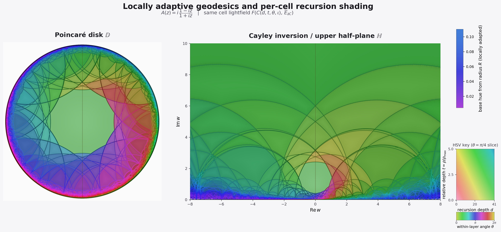
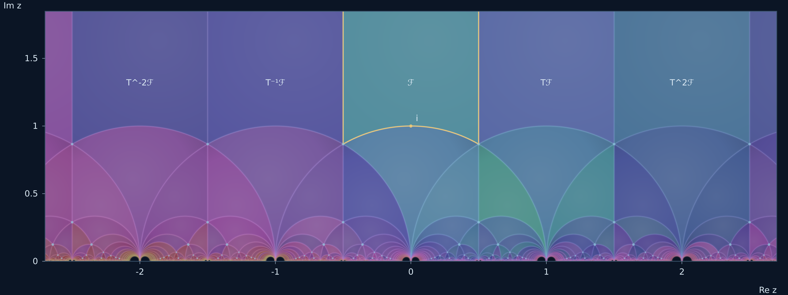

# Abstract-Algebra

抽象代数相关的计算实验与几何可视化。收录 Steiner 与 Pappus 圆链、嵌套阿波罗尼斯垫片、庞加莱圆盘与上半平面的对应着色，以及 SL₂(ℤ) 基本域的独立互动展开。

## 公开互动演示

**[进入完整演示目录](https://eliguli712.github.io/Abstract-Algebra/)**

页面顶部可选择 **中文 / English / Deutsch**，首页与三个互动实验均支持即时切换，并保留当前参数和语言偏好。

[中文](https://eliguli712.github.io/Abstract-Algebra/?lang=zh) · [English](https://eliguli712.github.io/Abstract-Algebra/?lang=en) · [Deutsch](https://eliguli712.github.io/Abstract-Algebra/?lang=de) · [语言设置说明](docs/LANGUAGES.md)

| 实验 | 公开运行 | 独立 HTML |
| --- | --- | --- |
| Steiner 与 Pappus 圆链 · v5 | [打开演示](https://eliguli712.github.io/Abstract-Algebra/circle-chains/steiner-pappus-v5.html) | [下载／查看源码](circle-chains/steiner-pappus-v5.html) |
| 嵌套阿波罗尼斯垫片 · v2 | [打开演示](https://eliguli712.github.io/Abstract-Algebra/circle-chains/nested-apollonian-v2.html) | [下载／查看源码](circle-chains/nested-apollonian-v2.html) |
| SL₂(ℤ) 上半平面展开 | [打开演示](https://eliguli712.github.io/Abstract-Algebra/sl2z/) | [下载／查看源码](sl2z/index.html) |

圆链页面支持独立调参、逐层旋转、暂停、反向与 PNG 导出。两个导入的 HTML 在原有绘图与互动逻辑上增加了三语界面；[操作说明与来源校验](docs/CIRCLE_CHAINS.md)列出各项控件和导入时的 SHA-256。所有独立互动页面可下载后离线打开。



## SL₂(ℤ) 互动展开

下载 [sl2z/index.html](sl2z/index.html)，用浏览器打开即可离线探索。页面已包含全部样式、几何、互动和着色代码。

- 逐区前进／后退、区域滑杆、点选整数矩阵、尖点和最短字长。
- 深度 0–18 展开、自动逐层展开、S/T/T⁻¹、聚焦、撤回选区、复位和缩放。
- 自适应彩虹、青蓝深海、紫兰暮光；逐区域基色、深度色移、内部柔光和邻域协调描线。
- 保持已有区域颜色稳定，支持同层区域色差和底部微小区域上色。
- 键盘、鼠标拖动与双指缩放，当前视野 SVG 和三倍分辨率 PNG 导出。



[互动与快捷键](sl2z/README.md) · [数学结构](docs/SL2Z_MATHEMATICS.md) · [着色方法](docs/SL2Z_COLOR_GRADIENTS.md)

构建及检查：

    python3 scripts/build_sl2z.py
    npm ci
    npm test

青蓝静态参考图由 scripts/render_sl2z.py 复现，输出位于 outputs/sl2z；
互动版的 SVG/PNG 导出使用当前选择的颜色与视野。
深度 18 累计 35,416 个区域，逐区基色由固定颜色表保持稳定。

## 庞加莱对应着色功能

- 左右两幅图共享区域标签、颜色查找表与内部光场，通过 Cayley 变换保持空间对应。
- 填充色由分隔深度、相对径向位置、角位置和确定性的区域相位共同决定。
- 相邻圆弧的平均颜色参与填充；内部圆弧、外轮廓随附近色彩自动协调。
- 保留细胞状分界、柔和内部渐变与低透明度辉光，靠近边缘的微小区域也参与填充。
- 支持自适应 HSV 彩虹，以及 orchid、abyss、ember、moss、graphite 配色。
- 输出变换往返误差、着色区域数、同层量化颜色碰撞等检查结果。

## 安装与运行

使用 Python 3.10 或更新版本。建议建立独立环境：

```bash
python3 -m venv .venv
source .venv/bin/activate
python -m pip install -r requirements.txt
mkdir -p outputs
MPLBACKEND=Agg python poincare_face_shading_2.py -o outputs/poincare_rainbow.png
```

Windows 可使用 `.venv\Scripts\activate` 激活环境；创建 `outputs` 文件夹后直接执行相同的 Python 命令即可。`MPLBACKEND=Agg` 用于无图形界面的环境。

更换配色或降低分区栅格分辨率：

```bash
python poincare_face_shading_2.py --palette orchid -o outputs/poincare_orchid.png
python poincare_face_shading_2.py --raster 1600 -o outputs/poincare_quick.png
python poincare_face_shading_2.py --help
```

`--raster` 仅调整圆盘分区栅格；上半平面采样尺寸及导出尺寸在程序中单独设定。降低它可减少分区计算开销，同时会改变可识别的微小区域数量。输出目录须预先存在。

## 文件说明

| 文件 | 内容 |
| --- | --- |
| [poincare_face_shading_2.py](poincare_face_shading_2.py) | 完整的几何生成、分区标记、着色和绘图程序 |
| [requirements.txt](requirements.txt) | NumPy、Matplotlib、SciPy 依赖 |
| [docs/POINCARE_SHADING.md](docs/POINCARE_SHADING.md) | 数学映射、颜色机制、参数和数值口径 |
| [CHANGELOG.md](CHANGELOG.md) | 导入及后续修改记录 |
| [assets/poincare_adaptive_rainbow.png](assets/poincare_adaptive_rainbow.png) | 已提交的高分辨率示例图 |

分隔深度是相对于基点、由当前绘制圆弧计算的计数。分区和微小区域填充采用有限栅格近似；完整定义及使用边界见[方法说明](docs/POINCARE_SHADING.md)。


