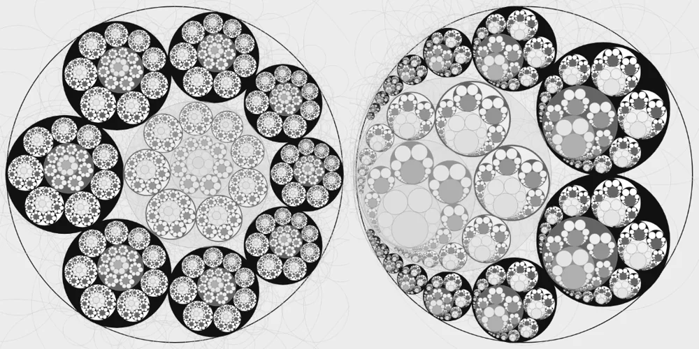
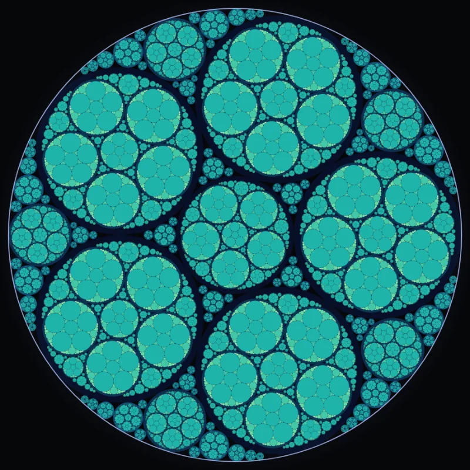

# 圆链与嵌套阿波罗尼斯互动实验

这两个独立 HTML 页面来自作者提供的版本，发布时保持原始文件内容。它们与仓库已有的 SL₂(ℤ) 可视化共同列在[演示目录](../index.html)。

## Steiner 与 Pappus 圆链 · v5

[打开页面](../circle-chains/steiner-pappus-v5.html) · [公开演示](https://eliguli712.github.io/Abstract-Algebra/circle-chains/steiner-pappus-v5.html)

- 左侧显示 Steiner 闭合圆链，右侧显示 Pappus 上下双链。
- 两侧独立调节偏心参数 L、圆数 N、递归深度、基础角速度、内层加速与初始相位差。
- 「同步右←左」复制左侧参数；暂停和方向按钮控制动画。
- 可切换逐层反演、中心圆递归、灰色圆心轨迹和浅灰内圆叠加。
- 支持单独导出 Steiner、Pappus，以及合并双图的 PNG。

预览：



## 嵌套阿波罗尼斯垫片 · v2

[打开页面](../circle-chains/nested-apollonian-v2.html) · [公开演示](https://eliguli712.github.io/Abstract-Algebra/circle-chains/nested-apollonian-v2.html)

- 调节环数、种子变形幅度与方向、嵌套深度、垫片生成代数和最小半径。
- 选择六种调色板，按嵌套深度、生成层级或曲率的模数分类着色。
- 切换整数种子 (−1, 2, 2, 3)、曲率标注、描边、明暗交替和辉光。
- 调节基础角速度与逐层加速，支持暂停、反向和 PNG 导出。

预览：



## 运行与数值口径

直接用现代浏览器打开 HTML，或在仓库根目录运行：

```bash
python3 -m http.server 8000
```

访问 `http://localhost:8000/`。两个页面均将 JavaScript 和样式内嵌，无外部脚本或在线字体依赖。

递归深度、最小半径、像素剔除和调用次数上限决定有限分辨率下的绘制结果。阿波罗尼斯页面中的模数统计反映当前有限模板；一般种子下的曲率标注与模数着色使用四舍五入值。精确的整数曲率实验应勾选整数种子。每个嵌套副本的曲率采用其自身归一化坐标。

## 来源与完整性

| 原始文件名 | 仓库路径 | SHA-256 |
| --- | --- | --- |
| Steiner pappus v5.html | `circle-chains/steiner-pappus-v5.html` | `acfadfcf6a81f540dd0b9f39733b0affdd23a82e879d53ba8026dd98d766174f` |
| Nested apollonian v2.html | `circle-chains/nested-apollonian-v2.html` | `e2a9983513c35e11a182e02c40a972733a7458a75b75dac8ed9db08cc892017f` |

预览图由这两个页面的默认绘图代码生成。发布前完成脚本解析、初始 Canvas 绘制、暂停与反向、参数同步、整数种子、着色切换和四种 PNG 导出路径的本地检查。
